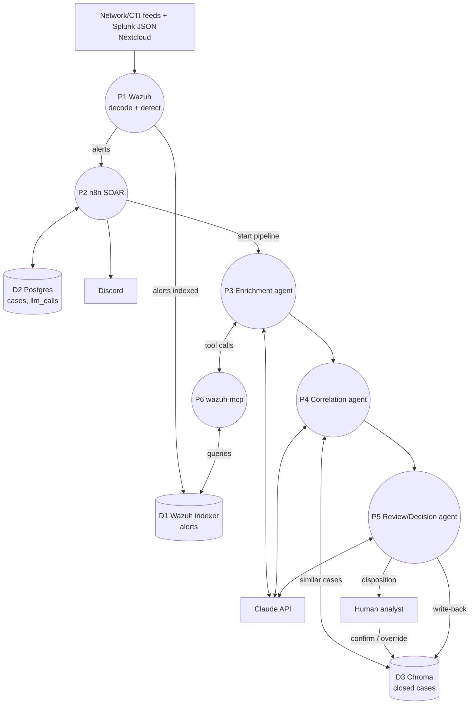

# Architecture

Source of design: the Notion page "Agentic SOC Triage Pipeline" (Projects). This doc reflects that
design plus the repo-specific choices (Wazuh MCP server, Nextcloud cold storage, Claude API).

## Components

| Role | Tool | Where it runs |
|------|------|---------------|
| SIEM / detection | Wazuh (manager + indexer + dashboard) | Wazuh VM (Proxmox) |
| SOAR / orchestration | n8n | DockerHome VM |
| Case management | Thin case table in n8n's existing Postgres (TheHive/Cortex reserved for the GCP lab) | DockerHome VM |
| Agent knowledge store | Chroma (vector store of closed cases) | DockerHome VM |
| LLM call tracking | Postgres `llm_calls` table (optional Langfuse later) | DockerHome VM |
| Agent tool access | `mcp-servers/wazuh-mcp` (MCP over streamable-http) | DockerHome VM |
| Notification | Discord | external |
| Inference | Claude API (no local models) | external |
| Cold storage | Nextcloud (raw ~120GB Splunk JSON, archived indices) | existing homelab service |

## Provisioning

The `wazuh` VM is provisioned on Proxmox via OpenTofu — see [../infra/](../infra/). It is cloned
from an existing cloud-init template; the repo does not build the template. The `dockerhome` VM
already exists and is not managed by this repo's OpenTofu config.

## Data flow

1. **Ingest:** Splunk-format JSON logs (EDR-style events) are replayed from Nextcloud into Wazuh
   through a custom Wazuh decoder for the Splunk schema. Network and CTI feeds come from
   open-source feeders. Wazuh generates detection alerts into its indexer.
2. **Orchestrate:** Wazuh alerts are sent to n8n, which creates/updates cases in Postgres (reading
   case state back so already-open cases don't re-alert) and starts the agent pipeline.
3. **Agent pipeline (three stages, deliberately decomposed):**
   - **Enrichment** — user/role context, alert volume vs. peer group; pulls related alerts via
     `wazuh-mcp` (`search_alerts`, `get_alert`).
   - **Correlation** — rule-table fast path for known patterns, then top-k similar closed cases from
     Chroma (structured-field filter first, semantic similarity second).
   - **Review/Decision** — disposition + confidence + cited precedent cases; below-threshold cases
     go to human review.
4. **Notify:** n8n posts to Discord, throttled per case update rather than per alert.
5. **Feedback loop:** every agent disposition and human confirm/override is written back to Chroma
   as a new labeled case. Every LLM call is logged to `llm_calls` keyed by `case_id`.

### Data flow diagram

Not yet drawn: the Review agent's disposition returning to n8n to close the case. Keep this diagram
in sync when flows change.

## Repo tooling notes

- `infra/tofu.sh` loads `infra/.env` (holds `TF_VAR_proxmox_api_token`) before running `tofu`;
  non-secret settings live in `infra/terraform.tfvars`. `ssh_public_key` is optional.
- The `proxmox-vm` module declares its own `required_providers` (`bpg/proxmox`); without it
  OpenTofu resolves `hashicorp/proxmox` and `tofu init` fails.

## Why an MCP server for Wazuh

Agents call Wazuh through a small read-only tool surface instead of raw OpenSearch access. The
indexer credentials stay in one service, and every agent stage shares the same tools.

## Open decisions (from the Notion page)

- Final Network / EDR / CTI feed sources.
- Whether n8n only writes new cases or also reads case state back (leaning: read back).
- Optional DLP dataset: CMU CERT Insider Threat r6.2 (needs a rules layer to derive alerts/labels).
- Optional self-hosted Langfuse for trace UI.
